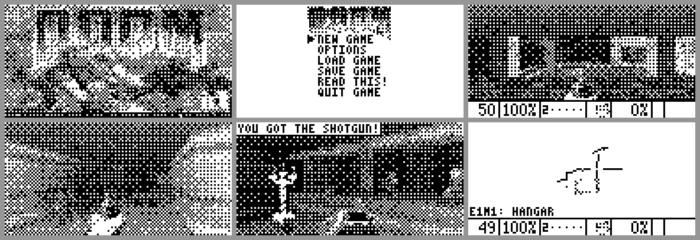

# CasioDoom

A port of the original **DOOM** to the **CASIO fx-9860GIII** graphing
calculator, as an add-in: 128×64 pixels, 1 bit per pixel, no sound.



> **Status: not yet tested on a real calculator.**
> The engine is complete and runs in a PC test build that uses exactly the
> same code as the calculator (it replays the original `DEMO1–3` in sync with
> the original game). The calculator code compiles with `sh-elf-gcc` against
> the gint headers, but the final `.g1a` has not been linked or run on real
> hardware. The riskiest parts are locating the WAD inside flash memory and
> the amount of free RAM (see [How it works](#how-it-works)). Expect the
> first run to need some tuning.

## Why

No DOOM port existed for the fx-9860GIII. The machine is a tough target: a
128×64 monochrome LCD, roughly 100 KB of RAM for an add-in and 3 MB of
storage, while the original game wants 4 MB of RAM and a 4–12 MB data file.
This project is an attempt to fit the *real* game into it, original game
logic included, rather than a look-alike.

## Based on

This is a derivative of the original DOOM source code released by
id Software:

- **<https://github.com/id-software/DOOM>** (`linuxdoom-1.10`), © id Software,
  released under the GNU General Public License.

All credit for the game goes to id Software. This repository contains only
source code. **No game data is included**: you need the shareware
`doom1.wad` or a copy of the game you own. DOOM is a registered trademark of
id Software LLC; this is an unofficial fan project, not affiliated with or
endorsed by id Software, Bethesda or CASIO.

The add-in is built on [gint](https://git.planet-casio.com/Lephenixnoir/gint)
and the [fxSDK](https://git.planet-casio.com/Lephenixnoir/fxsdk) by
Lephenixnoir. The idea of reading the WAD straight from flash comes from
CGDoom, the fx-CG port.

## What is kept

- the complete original game logic (monsters, weapons, doors, lifts,
  switches, teleporters, secrets, all five skill levels),
- menus: new game / episode / skill, options, 6 save slots, help, quit,
- status bar with the face, automap (zoom, follow, grid, marks),
- intermission tally and episode map, finale texts, the DOOM II cast,
- the "melt" screen wipe and the title loop with demos,
- cheats: they cannot be typed on a calculator, so they are in
  *Options → Cheats* (IDDQD, IDFA, IDKFA, IDCLIP, IDDT).

Missing: sound and music, colour, multiplayer, demo recording, low detail
mode. The view has two sizes only (with status bar / full screen), and a
saved game is named after its level because there is no way to type a name.

## How it works

**The WAD is never loaded.** The calculator has far too little RAM for even
one level. A converter (`tools/wad2calc.py`) turns a DOOM WAD into a
"calculator WAD", `DOOM.CWD`, in which levels are stored as ready-to-use,
pointer-free structures. At start-up the add-in locates every sector of that
file in the flash chip, which is visible in the CPU's address space, and
then reads level geometry, textures and sprites **directly from flash**.
Only what changes during play lives in RAM:

| | size |
|---|---|
| 128×64 frame buffer (64 grey levels) + 1-bit copy | 9 KB |
| renderer work tables | ≈ 24 KB |
| other (HUD, tables, keys…) | ≈ 4 KB |
| static variables | 4 KB |
| level state (sectors, lines, things, monsters) | 21–72 KB depending on the level |

To make that possible the level data is split into a constant part in flash
and a small mutable part in RAM, a pressed switch is one bit per wall side,
scrolling walls are handled by the renderer, the state and monster tables
are constants in ROM, and things that never move use only part of `mobj_t`.
When memory runs low the game leaves out pure scenery (lamps, corpses) while
loading a level.

**Converter.** It drops sound and music, converts the palette to 64 grey
levels, composes and shrinks wall textures, sprites and flats, and replaces
the font, status bar and menu art with versions made for 128×64.

**Display.** The renderer draws into an 8-bit grey buffer, so distance
lighting works as in the original; the finished frame is then reduced to
1 bit with an 8×8 ordered dither and a contrast stretch. Damage and pickups
briefly darken / brighten the picture instead of changing the palette.

**Fidelity.** The game code is the original; only data access was changed.
The demos in the shareware WAD play back in sync, which is a good test that
the logic is intact.

## Getting it onto the calculator

1. **Convert a WAD** (Python 3, no extra packages):

   ```sh
   python3 tools/wad2calc.py doom1.wad                    # shareware -> DOOM.CWD (1.9 MB)
   python3 tools/wad2calc.py doom.wad  --maps E1M1-E1M9   # one episode only
   python3 tools/wad2calc.py doom2.wad --maps MAP01-MAP06 --shift 2
   ```

   The file has to fit into the 3 MB storage together with the add-in, so
   pick a subset of maps for the registered game or DOOM II.
   `--shift 0/1/2` selects full / half (default) / quarter size graphics.

2. **Build the add-in** with the fxSDK and gint ≥ 2.9:

   ```sh
   fxsdk build-fx          # produces CasioDoom.g1a
   ```

   `.github/workflows/build.yml` is meant to do the same on GitHub Actions
   and publish the `.g1a` as an artifact; it has not been run yet.

3. **Install.** On the calculator run *MEMORY → Storage Memory →
   Optimization* first (important: `DOOM.CWD` should lie contiguously in
   flash), then copy `DOOM.CWD` and `CasioDoom.g1a` to the root of the
   storage memory over USB and start the **DOOM** add-in.

Saved games (`DOOMSAV0.DSG`…`DOOMSAV5.DSG`) and settings (`DOOM.CFG`) are
written to the storage memory.

## Controls

| key | action |
|---|---|
| arrows | move / turn |
| `SHIFT` | fire |
| `ALPHA` | use / open |
| `OPTN` (hold) | strafe instead of turning |
| `VARS` (hold) | run |
| `F5` / `F6` | step left / right |
| `1`–`7` | weapons |
| `F1` | automap (`+`/`−` zoom, `0` whole map, `X,θ,T` follow, `log` grid, `ln` mark, `sin` clear marks) |
| `F2` / `F3` | save / load |
| `F4` | brightness (5 levels) |
| `+` / `−` | full screen ↔ status bar |
| `EXIT` | menu / back |
| `EXE` | confirm ("yes"), repeat the last message |
| `DEL` | one menu level back |
| `AC/ON` | pause |
| `MENU` | calculator main menu |

## PC test build

`src/host` is a head-less build of the same engine with virtual time,
scripted keys and frame dumps:

```sh
make -C src/host
python3 tools/wad2calc.py doom1.wad -o test.cwd --endian little
src/host/doomhost -wad test.cwd -warp 1 1 -frames 300 -dump frames -every 20 \
    -keys "50:up 150:-up 160:fire 165:-fire"
src/host/doomhost -wad test.cwd -playdemo DEMO1 -frames 3000   # sync test
```

Other options: `-heap N`, `-frag N` (simulate a fragmented file),
`-skill 1-5`, `-exitlevel T`, `-finale T`. On exit it prints how much RAM
the level would need on the calculator.

## Layout

| | |
|---|---|
| `tools/wad2calc.py` | WAD → `DOOM.CWD` converter |
| `tools/gentables.c` | generator of `src/r_viewtab.c` (tables for a 128 pixel wide view) |
| `src/*.c` | the engine (modified `linuxdoom-1.10`) |
| `src/fx/i_fx.c` | calculator layer (gint): display, keys, timer, files, WAD in flash |
| `src/host/` | PC test build |
| `CMakeLists.txt` | fxSDK build |

## How it was made

The port, the converter and this documentation were written by an AI coding
agent, [Claude Code](https://claude.com/claude-code) by Anthropic, in a
single session of roughly seven hours, directed by the repository owner. No
calculator was attached to that session, which is why the result is
untested on hardware.

Usage of that session as reported by the tool when this file was written:

| | |
|---|---|
| output tokens | ≈ 0.33 million |
| fresh input tokens | ≈ 0.05 million |
| cached context written | ≈ 1.1 million |
| cached context re-read | ≈ 57 million |
| cost | **≈ 42 USD** |

## License

id Software released the DOOM source code under the GNU General Public
License, version 2; that licence text, exactly as it ships in the upstream
repository, is included here as `LICENSE-DOOM.txt`. (Many source files
still carry the header of the older "DOOM Source Code License", as they do
upstream; the GPL release supersedes it.)

CasioDoom port: Copyright (C) 2026 aurasscz. Written with
[Claude Code](https://claude.com/claude-code) (Anthropic).
DOOM source code: Copyright (C) 1993-1996 id Software, Inc.

If you redistribute or modify this project, the GPL requires you to keep
these copyright notices (in the files and on the in-game credits page)
intact and to state what you changed.

The changes and additions made for this port are offered under the GNU GPL,
version 2 or (at your option) any later version; `LICENSE` holds the text
of version 3. Game data is not covered and not included.
